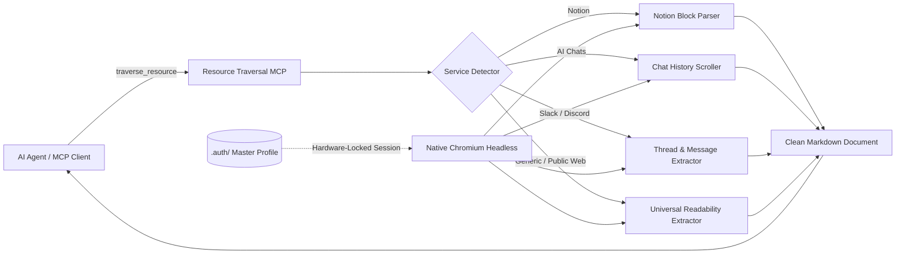

# Resource Traversal MCP — The Universal Web Key

**Vision:** Transforming static pointers into live cognitive portals.

**Developer:** Kavia Shirkoohi ([shirkoohi.com](https://shirkoohi.com))

---

## What It Does

The **Resource Traversal MCP** gives your AI agent "eyes" and "keys" across both the authenticated and public web. In a modern workflow, your **Command Centre (Notion / Notes) provides Structure**, your **Cloud & Repositories provide Data**, and this engine is the **Connective Tissue** that allows AI agents to traverse, read, and reason over private web resources on demand.

Instead of relying on fragile or restricted third-party APIs, it utilizes a **Native Chromium Headless Architecture** to inherit your existing browser sessions. If you can see it in your browser, your AI can now traverse it as a first-class observer.

---

## Core Breakthroughs

1. **Unified Auth Layer:** AI inherits your permissions via a local "Master Profile" (`.auth/` folder). No API keys or developer accounts required.
2. **Native Chromium Stealth:** Uses `--headless=new` with hardware-locked OS encryption (macOS Keychain / Windows DPAPI) to remain undetectable by Cloudflare and bot-protection walls.
3. **Temporal Navigation:** Specialised scrolling logic for SPAs (Single Page Applications) to capture full multi-turn conversation histories and archived threads, not just the visible viewport.
4. **Universal Web Traversal:** Verified success across high-friction targets including **Notion, Slack, Discord, Gemini, ChatGPT, Grok, Raindrop.io, and Google Workspace**.
5. **Intelligent Fallback:** Any arbitrary web link, documentation portal, or article is automatically extracted with navigation menus, sidebars, cookie banners, and popups filtered out.

---

## Architecture & Data Flow



---

## Prerequisites

Before starting, ensure you have the following installed:
- **[Bun](https://bun.sh):** Fast JavaScript runtime (`curl -fsSL https://bun.sh/install | bash`).
- **Google Chrome:** Required for the native headless engine and hardware encryption profile.

---

## Quick Start

### 1. Install Dependencies
```bash
bun install
```

### 2. The Universal Auth Key (One-Time Login)
Unlock any service for your AI in seconds:
```bash
bun run auth [URL]
```
*Examples:*
* Notion: `bun run auth https://app.notion.com`
* ChatGPT: `bun run auth https://chatgpt.com`
* Slack: `bun run auth https://app.slack.com`

Log in manually in the browser window that opens, then close the browser. Your session cookies and localStorage are securely stored in `.auth/` using OS-level hardware encryption.

### 3. Run the Automated Test Suite
Verify that all extractors, service detection rules, and headless browser engines are healthy:
```bash
bun run test
```

---

## MCP Client Configuration

Add the server to your MCP client configuration (e.g. `claude_desktop_config.json`, Antigravity `settings.json`, Cursor `.cursor/mcp.json`, or Windsurf):

```json
{
  "mcpServers": {
    "resource-traversal": {
      "command": "bun",
      "args": ["run", "/path/to/resource-traversal-mcp/index.ts"]
    }
  }
}
```

---

## Available Tools

| Tool | Parameters | Description |
|:---|:---|:---|
| **`traverse_resource`** | `url` *(string, required)*<br>`raw` *(boolean, optional)* | Traverses any authenticated or public URL, applies domain-specific extraction, and returns clean Markdown. Set `raw: true` to bypass specialized extractors. |
| **`check_auth`** | *(none)* | Checks whether a valid local `.auth/` master profile session exists. |

---

## Supported Portals & Extraction Capabilities

| Category | Supported Platforms | Features & Handling |
|:---|:---|:---|
| **Workspaces & Notes** | ✅ **Notion** (`notion.so`, `notion.site`, `app.notion.com`), Google Docs, NotebookLM | Structural block hierarchy (`#` headings, `- [x]` checklists, toggles, callouts, code blocks, quote blocks) |
| **AI Conversations** | ✅ **Gemini**, **ChatGPT**, **Grok** | Automatic scroll-back to load full conversation history and message roles (`**User:**` vs `**Assistant:**`) |
| **Messaging & Communities** | ✅ **Slack**, **Discord** | Channel archives, message threads, direct messages, and timestamped author labels |
| **Repositories & Bookmarks** | ✅ **GitHub**, 🧪 **Raindrop.io** | Repository code/issue inspection, bookmark lists |
| **Universal Fallback** | ✅ **Any Arbitrary URL / Documentation / Article** | Semantic content isolation (`<main>`, `<article>`), stripping cookie banners, popups, headers, and footer noise |

---

## 🏗️ Modular Extensibility & Self-Healing

The project is structured as a **Modular Ecosystem**:
- **Custom Adapters:** Add new site extractors to [`lib/extractors.ts`](./lib/extractors.ts) in just a few lines of code.
- **Universal Fallback:** When a site changes its layout or an unsupported URL is supplied, the tool automatically uses `extractGeneric` to ensure no link is a dead end.
- **Self-Healing Strategy:** System prompts in [`SYSTEM_PROMPTS.md`](./SYSTEM_PROMPTS.md) instruct AI agents to detect DOM drift and dynamically adapt or suggest selector patches.

---

## 🔒 Privacy & Security

- **Local-First:** Your credentials, tokens, and cookies never leave your local machine.
- **Zero-Cloud:** No intermediary proxies or servers. Traffic flows directly between Chromium and the target service.
- **Consensual Observation:** The AI only enters portals you explicitly unlock via `bun run auth`.

---

## ⚠️ Honest Limitations & Edge Cases

1. **No Dedicated Linear or Jira Extractors:** `SERVICE_PATTERNS` only routes Notion, Gemini, ChatGPT, Grok, Slack, Discord, Google Docs, NotebookLM, and Raindrop.io. Other apps (such as Linear or Jira) have no custom DOM extractors and fall back to `extractGeneric`.
2. **Google Docs Canvas Rendering:** Text in Google Docs is rendered to a `<canvas>` element rather than standard DOM nodes, making DOM text extraction unreliable. Use a dedicated Google Drive/Docs API MCP server where character-level fidelity is required.
3. **Session Lifespans:** Local `.auth/` cookies eventually expire. When a login wall is encountered, run `bun run auth [URL]` to refresh the session.
4. **SPA Hydration Delay:** Heavy Single Page Applications (Notion, Slack, Discord) may take 15–30 seconds during initial cold-start hydration while client bundles load.

---
